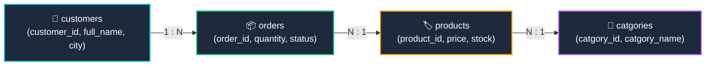

# 🚀 Advanced MySQL Analytics: Multi-Table Joins, Revenue Metrics & Subqueries

[](https://www.mysql.com/)
[]()
[]()
[]()
[](https://islamyasser424-design.github.io/portfolio-/)

> **A high-impact SQL analytical portfolio project engineering advanced multi-table relational joins, product revenue formulas ($\sum \text{Price} \times \text{Quantity}$), dynamic catalog scalar subqueries, and multi-tier customer profiling across an e-commerce ecosystem.**

---

## 📌 Table of Contents
- [✨ Business Context & Executive Summary](#-business-context--executive-summary)
- [📐 4-Tier Relational Schema Traversal](#-4-tier-relational-schema-traversal)
- [🔍 Assessment Solutions & Query Walkthrough](#-assessment-solutions--query-walkthrough)
  - [Q1: Regional Market Audit (Cairo Order Volume & Avg Basket Size)](#q1-regional-market-audit-cairo-order-volume--avg-basket-size)
  - [Q2: Customer Purchase Frequency & Repeat Order Ranking](#q2-customer-purchase-frequency--repeat-order-ranking)
  - [Q3: Product Gross Revenue & Category GMV Breakdown](#q3-product-gross-revenue--category-gmv-breakdown)
  - [Q4: Catalog Outlier Detection via Dynamic Scalar Subquery](#q4-catalog-outlier-detection-via-dynamic-scalar-subquery)
  - [Q5: Multi-Hop Traversal: Unique Electronics Customers (`DISTINCT`)](#q5-multi-hop-traversal-unique-electronics-customers-distinct)
- [🚀 Execution Guide](#-execution-guide)
- [👤 Author & Connect](#-author--connect)

---

## ✨ Business Context & Executive Summary

In enterprise business intelligence, extracting decision-ready metrics requires navigating multiple normalized relational entities simultaneously:
1. **Multi-Table Traversal:** Joining across up to 4 separate normalized entities (`customers` $\to$ `orders` $\to$ `products` $\to$ `catgories`) to isolate target demographics based on product categories.
2. **Financial Aggregation:** Calculating line-item gross revenue directly within SQL using vectorized arithmetic (`SUM(p.price * o.quantity)`).
3. **Dynamic Benchmarking:** Employing scalar subqueries (`price > (SELECT AVG(price) FROM products)`) to dynamically separate premium SKUs without hardcoding arbitrary threshold values.

---

## 📐 4-Tier Relational Schema Traversal



---

## 🔍 Assessment Solutions & Query Walkthrough

### Q1: Regional Market Audit (Cairo Order Volume & Avg Basket Size)
**Objective:** Calculate the total number of orders and the average units per order placed by customers located in Cairo.
```sql
SELECT 
    COUNT(o.order_id) AS cairo_total_orders,
    ROUND(AVG(o.quantity), 2) AS cairo_avg_units_per_order
FROM orders o
INNER JOIN customers c 
    ON o.customer_id = c.customer_id
WHERE c.city = 'Cairo';
```
#### Output:
| cairo_total_orders | cairo_avg_units_per_order |
|:---:|:---:|
| **4** | 1.50 |

---

### Q2: Customer Purchase Frequency & Repeat Order Ranking
**Objective:** Profile customers by total order count, sorting from highest order frequency to lowest.
```sql
SELECT 
    c.customer_id,
    c.full_name,
    c.city,
    COUNT(o.order_id) AS total_orders_placed
FROM customers c
INNER JOIN orders o 
    ON c.customer_id = o.customer_id
GROUP BY c.customer_id, c.full_name, c.city
ORDER BY total_orders_placed DESC, c.full_name ASC;
```
#### Output:
| customer_id | full_name | city | total_orders_placed |
|:---:|:---|:---|:---:|
| **1** | Ahmed Ali | Cairo | 3 |
| **2** | Sara Hassan | Alexandria | 2 |
| **3** | Mona Khalil | Giza | 1 |
| **4** | Omar Saad | Cairo | 1 |
| **5** | Nour Fathy | Luxor | 1 |

---

### Q3: Product Gross Revenue & Category GMV Breakdown
**Objective:** For each product, calculate unit price, total units sold, and total generated revenue.
```sql
SELECT 
    p.product_id,
    p.product_name,
    cat.catgory_name AS category_name,
    p.price AS unit_price,
    SUM(o.quantity) AS total_units_sold,
    SUM(p.price * o.quantity) AS total_sales_revenue
FROM products p
INNER JOIN catgories cat 
    ON p.catgory_id = cat.catgory_id
INNER JOIN orders o 
    ON p.product_id = o.product_id
GROUP BY p.product_id, p.product_name, cat.catgory_name, p.price
ORDER BY total_sales_revenue DESC;
```
#### Output:
| product_id | product_name | category_name | unit_price | total_units_sold | total_sales_revenue |
|:---:|:---|:---|:---:|:---:|:---:|
| **1** | Laptop Pro | Electronics | 15000.00 | 3 | **45,000.00** |
| **4** | Jeans Classic | Clothing | 650.00 | 2 | **1,300.00** |
| **2** | Wireless Mouse | Electronics | 350.00 | 2 | **700.00** |
| **3** | T-Shirt XL | Clothing | 200.00 | 3 | **600.00** |
| **5** | MySQL Mastery | Books | 180.00 | 2 | **360.00** |
| **6** | Garden Hose | Home & Garden | 120.00 | 1 | **120.00** |

---

### Q4: Catalog Outlier Detection via Dynamic Scalar Subquery
**Objective:** Display all catalog products whose price exceeds the overall catalog average.
```sql
SELECT 
    product_id,
    product_name,
    price,
    stock,
    (SELECT ROUND(AVG(price), 2) FROM products) AS catalog_avg_price,
    ROUND(price - (SELECT AVG(price) FROM products), 2) AS premium_variance
FROM products
WHERE price > (SELECT AVG(price) FROM products)
ORDER BY price DESC;
```
#### Output:
| product_id | product_name | price | stock | catalog_avg_price | premium_variance |
|:---:|:---|:---:|:---:|:---:|:---:|
| **1** | Laptop Pro | 15000.00 | 10 | 2750.00 | +12,250.00 |

*Analytical Finding:* The catalog average is heavily skewed upward by the high-value flagship SKU (*Laptop Pro* at $15,000 EGP), highlighting the importance of median and trimmed averages in e-commerce pricing strategies.

---

### Q5: Multi-Hop Traversal: Unique Electronics Customers (`DISTINCT`)
**Objective:** Extract unique customer profiles who have purchased at least one product in the **Electronics** category.
```sql
SELECT DISTINCT 
    c.customer_id,
    c.full_name,
    c.email,
    c.city
FROM customers c
INNER JOIN orders o 
    ON c.customer_id = o.customer_id
INNER JOIN products p 
    ON o.product_id = p.product_id
INNER JOIN catgories cat 
    ON p.catgory_id = cat.catgory_id
WHERE cat.catgory_name = 'Electronics'
ORDER BY c.customer_id ASC;
```
#### Output:
| customer_id | full_name | email | city |
|:---:|:---|:---|:---|
| **1** | Ahmed Ali | ahmed@mail.com | Cairo |
| **4** | Omar Saad | omar@mail.com | Cairo |

---

## 🚀 Execution Guide

```bash
# Clone the repository
git clone https://github.com/islamyasser424-design/SQL-Quiz-3.git
cd SQL-Quiz-3

# Run queries against active online_store database
mysql -u root -p online_store < SQL_Quiz_03_MultiTable_Joins_Subqueries.sql
```

---

## 👤 Author & Connect

* **Author:** Islam Yasser — *Data Analyst & Business Intelligence Specialist*
* **Portfolio:** [islamyasser424-design.github.io/portfolio-/](https://islamyasser424-design.github.io/portfolio-/)
* **LinkedIn:** [linkedin.com/in/islam-yasser-55048b378](https://www.linkedin.com/in/islam-yasser-55048b378/)
* **GitHub:** [github.com/islamyasser424-design](https://github.com/islamyasser424-design)